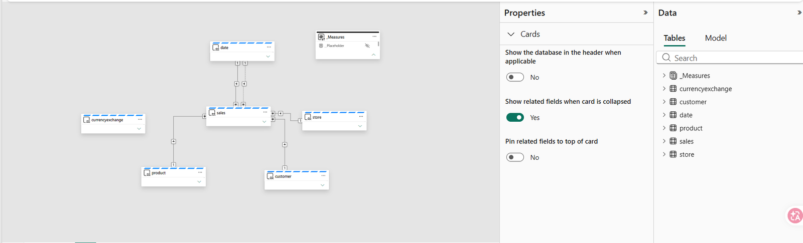
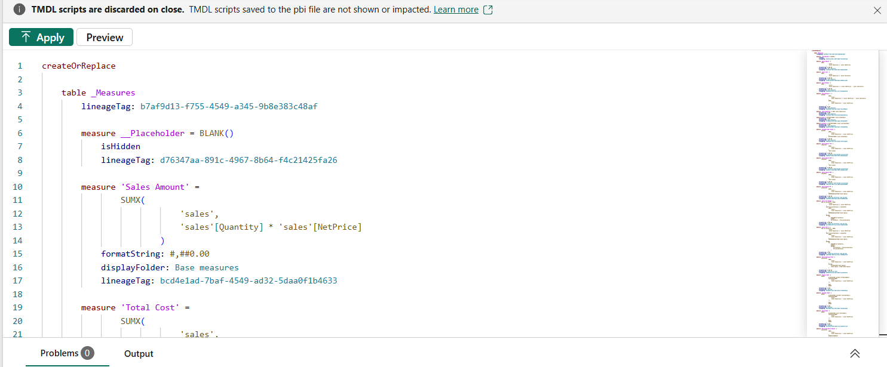
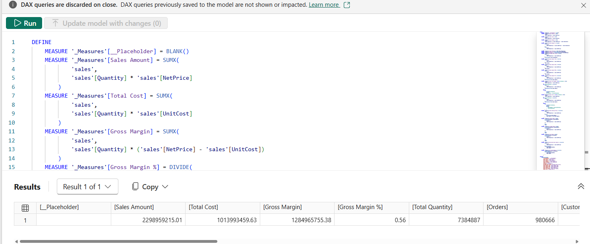
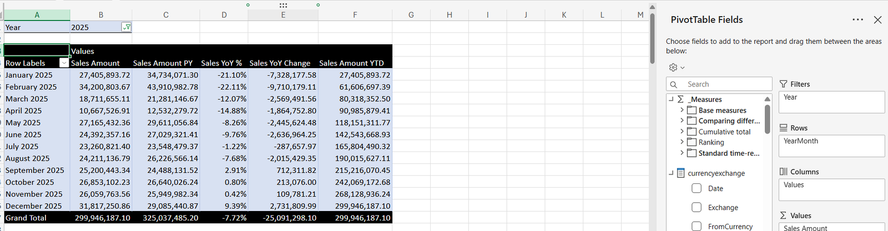

# Microsoft Fabric Contoso Sales Analytics

End-to-end sales analytics and data-quality solution built with Google Colab, OneDrive, Microsoft Fabric Lakehouse, SQL analytics endpoint, PySpark, a DirectQuery semantic model, DAX, Power BI, Excel, and GitHub integration.

## Project Overview

This project demonstrates a complete analytics workflow for the Contoso sales dataset. The source CSV files were prepared and corrected in Google Colab, stored in OneDrive, loaded into Microsoft Fabric, validated independently across four analytical engines, modeled as a star schema, and exposed through Power BI and Excel.

The solution focuses on:

- reproducible source-data preparation
- geographic data-quality correction
- OneDrive-to-Fabric ingestion
- Lakehouse and SQL analytics
- semantic modeling and reusable DAX measures
- cross-engine reconciliation
- Excel PivotTable analysis
- Git-based version control for Fabric workspace artifacts

## Architecture

```text
Contoso CSV source files
        |
        v
Google Colab
- source profiling
- coordinate validation
- controlled data corrections
- final CSV generation
        |
        v
OneDrive
- governed source-file location
        |
        v
Microsoft Fabric Dataflow Gen2
        |
        v
Fabric Lakehouse / Delta tables
        |                    |
        v                    v
SQL analytics endpoint    PySpark notebook
        |                    |
        +---------+----------+
                  v
        DirectQuery semantic model
                  |
        DAX measures and validation
                  |
          Power BI and Excel
                  |
             GitHub repository
```

## Microsoft Fabric Workspace

The Fabric workspace contains the end-to-end implementation:

- `Load_Contoso_From_OneDrive` - Dataflow Gen2 ingestion from OneDrive
- `ContosoCleanLakehouse` - Lakehouse containing the curated analytical tables
- `ContosoCleanLakehouse` SQL analytics endpoint - SQL validation and exploration
- `Contoso_Cross_Engine_Validation` - PySpark validation notebook
- `Contoso Clean Sales Model` - DirectQuery semantic model
- `Contoso Sales Performance` - Power BI report
- Git integration with this GitHub repository

## Source Data

The source layer contains eight final CSV files:

- `currencyexchange.csv`
- `customer.csv`
- `date.csv`
- `orderrows.csv`
- `orders.csv`
- `product.csv`
- `sales.csv`
- `store.csv`

The Fabric analytical model uses six loaded tables:

- `currencyexchange`
- `customer`
- `date`
- `product`
- `sales`
- `store`

## Data Preparation in Google Colab

Google Colab was used as the reproducible preparation and quality-control environment before the final source files were loaded into Fabric.

The workflow included:

- loading and profiling all eight CSV files
- validating expected file availability
- checking row and column counts
- detecting empty rows and fully empty columns
- detecting duplicate rows and duplicate business keys
- checking null-key values
- checking infinite numerical values
- validating latitude and longitude ranges
- identifying geographic mismatches between locations and coordinates
- separating valid overseas territories from genuine coordinate errors
- correcting 12 confirmed customer-coordinate mismatches
- correcting 6 records where `StateFull` was incorrectly classified as `Guyane` instead of `La Réunion`
- preserving the full `customer.csv` row count of 104,990 records
- overwriting the final source file without creating unnecessary production copies

The completed Colab validation covered 8 files and 5,890,897 rows.

## OneDrive Ingestion

The final validated CSV files are stored in OneDrive and used as the controlled source for Microsoft Fabric.

`Load_Contoso_From_OneDrive` loads the curated files into `ContosoCleanLakehouse`. Keeping the final source files outside the Fabric workspace separates source-file management from analytical processing while maintaining a repeatable ingestion path.

## Lakehouse and SQL Analytics Endpoint

The Fabric Lakehouse provides the curated analytical storage layer. The SQL analytics endpoint exposes the Lakehouse tables for relational validation and ad hoc analysis.

SQL validation confirmed the expected row counts and key integrity:

| Table | Rows | Duplicate keys | Null keys | Status |
|---|---:|---:|---:|---|
| `currencyexchange` | 100,450 | 0 | 0 | PASS |
| `customer` | 104,990 | 0 | 0 | PASS |
| `date` | 4,018 | 0 | 0 | PASS |
| `product` | 2,517 | 0 | 0 | PASS |
| `sales` | 2,349,091 | 0 | 0 | PASS |
| `store` | 74 | 0 | 0 | PASS |

## Cross-Engine Data Quality Validation

The solution validates the same curated data independently in four environments.

### Google Colab

Colab validates source files before ingestion, including structure, duplicates, keys, nulls, numerical anomalies, and coordinate ranges.

### SQL

The SQL analytics endpoint validates the six Lakehouse tables, expected row counts, primary or composite key uniqueness, and null-key counts.

### DAX

DAX Query View validates model-level row counts and key integrity after data reaches the semantic layer. All six model tables returned `PASS`.

### Python / PySpark

The Fabric notebook independently validates the Lakehouse tables with PySpark. The final run confirmed:

- 6 tables tested
- 2,561,140 total rows
- 0 tables requiring review
- final status: `PASS`

This layered validation reduces the risk of accepting a dataset merely because one engine or one transformation path produced a successful result.

## Semantic Model

The semantic model follows a star-schema design with `sales` as the fact table.

### Active relationships

- `sales[CustomerKey]` -> `customer[CustomerKey]`
- `sales[ProductKey]` -> `product[ProductKey]`
- `sales[StoreKey]` -> `store[StoreKey]`
- `sales[OrderDate]` -> `date[Date]`

### Inactive relationship

- `sales[DeliveryDate]` -> `date[Date]`

The inactive delivery-date relationship supports delivery-date calculations through `USERELATIONSHIP`. All relationships use one-direction filtering from the dimension side to the fact table.

The `currencyexchange` table remains disconnected and is available for future currency-conversion logic.



## DAX Measures

A dedicated `_Measures` table was created through TMDL because the model uses DirectQuery. Measures are organized into analytical display folders based on reusable DAX calculation patterns.

Implemented measure groups include:

- Base measures
- Standard time-related calculations
- Comparing different time periods
- Cumulative total
- Ranking
- Delivery-date analysis

Core measures include:

- Sales Amount
- Total Cost
- Gross Margin
- Gross Margin %
- Total Quantity
- Orders
- Customers
- Average Order Value
- Sales Amount MTD, QTD, and YTD
- Sales Amount PY
- Sales YoY Change
- Sales YoY %
- Sales Running Total
- Product, customer, and store ranking
- Delivered Sales Amount
- Delivered Orders

The YoY measures were explicitly corrected to return blank when the current period has no sales, preventing a false `-100%` result for calendar periods beyond the available sales data.



## DAX Query Validation

DAX Query View was used to execute the measures directly against the semantic model and verify aggregate results.

Validated results include:

| Metric | Result |
|---|---:|
| Sales Amount | 2,298,959,215.01 |
| Total Cost | 1,013,993,459.63 |
| Gross Margin | 1,284,965,755.38 |
| Gross Margin % | 55.89% |
| Total Quantity | 7,384,887 |
| Orders | 980,666 |
| Customers | 86,908 |
| Average Order Value | 2,344.28 |

Time-intelligence validation covered 2016-2026 and confirmed prior-year, year-over-year, YTD, and cumulative calculations. The cumulative sales result reconciled to total Sales Amount.



## Excel Analysis

The semantic model is also consumed through Excel PivotTables. This verifies that the governed measures can be reused outside the Power BI report rather than being limited to a single visualization layer.

The Excel analysis includes:

- Year filter
- monthly Sales Amount
- Sales Amount PY
- Sales YoY %
- Sales YoY Change
- Sales Amount YTD

For 2025, Excel reconciles to:

- Sales Amount: 299,946,187.10
- Sales Amount PY: 325,037,485.20
- Sales YoY Change: -25,091,298.10
- Sales YoY %: -7.72%



## Power BI Reporting

The Power BI report uses the shared semantic model and its governed measures. The report is designed to support:

- executive sales KPIs
- year filtering
- monthly performance analysis
- prior-year comparison
- year-over-year change
- cumulative performance
- geographic and ranking analysis

Because the calculations reside in the semantic model, Power BI and Excel consume the same business logic.

## Geographic Data Quality

Customer geography received additional validation because valid French overseas territories can appear outside metropolitan Europe.

The validation distinguished legitimate records in:

- Guadeloupe
- Martinique
- Mayotte
- La Réunion

from genuine coordinate mismatches. Six records for `Saint-Pierre` and `Le Tampon` were corrected from `StateFull = Guyane` to `StateFull = La Réunion`, while `CountryFull = France`, the city names, and the coordinates were preserved.

## Repository Structure

```text
fabric-contoso-sales-analytics/
├── Contoso Clean Sales Model.SemanticModel/
├── Contoso Sales Performance.Report/
├── Contoso_Cross_Engine_Validation.Notebook/
├── ContosoCleanLakehouse.Lakehouse/
├── Load_Contoso_From_OneDrive.DataflowGen2/
├── docs/
│   └── images/
│       ├── dax-query-measures-validation.png
│       ├── excel-sales-analysis-2025.png
│       ├── semantic-model-star-schema.png
│       └── tmdl-measures-definition.png
└── README.md
```

Fabric-generated folders preserve the workspace definitions required for source control and lifecycle management. Runtime data stored in OneLake is not duplicated in the Git repository.

## Technologies

- Microsoft Fabric
- Fabric Lakehouse
- SQL analytics endpoint
- Dataflow Gen2
- OneDrive
- Google Colab
- Python and pandas
- PySpark
- DAX
- TMDL
- DirectQuery semantic model
- Power BI
- Excel PivotTables
- GitHub
- Fabric Git integration

## Key Outcomes

- 8 source files and 5,890,897 rows validated before ingestion
- 12 confirmed coordinate mismatches corrected
- 6 geographic classifications corrected to `La Réunion`
- 104,990 customer rows preserved after correction
- 6 Fabric analytical tables reconciled across SQL, DAX, and PySpark
- 2,561,140 Lakehouse rows validated in the cross-engine test
- reusable DAX measures delivered through a dedicated `_Measures` table
- Power BI and Excel reuse the same semantic-model calculations
- Fabric workspace artifacts versioned in GitHub

## License

This project is licensed under the [MIT License](LICENSE).
